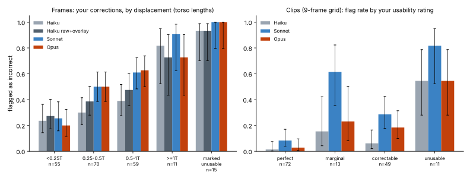

# LLM pose judge, part 2: against Viona's manual-review annotations

Follow-up to [part 1](2026-11-07-llm-pose-judge.md), which used synthetic errors and
AI-made labels. Viona asked "did you use my existing annotations to provide a
ground truth for this?" (no), then: "yes, use participant frames. i'd also like a
breakdown of error-detection by magnitude of error -- are these llms able to flag
gross errors sufficiently? and feel free to also analyze if filtering clips in this
way this impacts human rating correlation".

Exploratory, not thesis material; nothing is wired into the pipeline. Participant
frames were sent to the Anthropic models (approved by Viona in the thread above) but
no participant image, id or per-item model output is in Git. This entry and its
assets hold aggregates only.

## Data

Source: the manual-review release `20261002-first-manual-review` and
`svelte-web-frontend/artifacts/motion_metrics.csv`, read on Viona's MacBook. Items
were rendered there with
[`render_manual_review.py`](../motion-pipeline/adhoc_analysis/llm_pose_judge/render_manual_review.py)
using the same overlay as part 1.

1. **Frames (425)** from the 48 completed detailed frame reviews (CHI25 study 1,
   study 2 and the CHI reference corpus).
   - *Positives (210):* 195 frames with at least one landmark correction, and 15
     frames marked unusable. Error magnitude = largest corrected displacement in the
     frame divided by the torso length of the raw pose (median 0.42 T, IQR
     0.24-0.59 T). Corrections are almost all wrists (155) and elbows (32).
   - *Negatives (215):* 211 frames Viona did not mark, at least 8 frames from any
     marked frame, plus the 4 frames marked good. These are **weak negatives**: the
     review protocol does not certify unmarked landmarks as correct.
   - Legs are outside the current review protocol, so the prompt asked about the
     upper body only.
   - Near-duplicates were limited: positives at least 3 frames apart, unmarked frames
     at least 10 apart and at most max(3, positives) per segment.
2. **Usability clips (145):** the segments with a whole-segment usability rating and
   validated pose alignment (perfect 72, marginal 13, correctable 49, unusable 11),
   each shown as a 3×3 grid of 9 evenly spaced frames.
3. **Human-rated clips (730):** every CHI25 segment clip in `motion_metrics.csv` that
   has a human similarity rating and a matching video and raw pose (study 1: 613,
   study 2: 117), in the same 3×3 format.

Models: Haiku 5.5, Sonnet 5.5, Opus 5.5 at default effort, called through headless
Claude Code exactly as in part 1. Haiku was also run with the raw crop next to the
overlay. All 4,325 calls returned parseable JSON.

## Results: frames

Positive class = "skeleton incorrect". 95 % Wilson intervals in brackets.

| Model | Recall | Flag rate on unmarked | Precision | AUC |
|---|---|---|---|---|
| Haiku | 0.38 [0.32, 0.45] | 0.11 | 0.76 | 0.76 |
| Haiku, raw + overlay | 0.44 [0.37, 0.51] | 0.12 | 0.79 | 0.77 |
| Sonnet | 0.52 [0.46, 0.59] | 0.15 | 0.78 | 0.80 |
| Opus | 0.51 [0.44, 0.57] | 0.04 | 0.92 | 0.86 |

Recall by size of Viona's correction (Haiku / Haiku raw / Sonnet / Opus):

| Displacement | n | Haiku | Haiku raw | Sonnet | Opus |
|---|---|---|---|---|---|
| < 0.25 T | 55 | 0.24 | 0.27 | 0.25 | 0.20 |
| 0.25-0.5 T | 70 | 0.30 | 0.39 | 0.50 | 0.50 |
| 0.5-1 T | 59 | 0.39 | 0.47 | 0.61 | 0.63 |
| ≥ 1 T | 11 | 0.82 | 0.73 | 0.91 | 0.73 |
| frame marked unusable | 15 | 0.93 | 0.93 | 1.00 | 1.00 |

- **Gross errors.** Frames Viona marked unusable are caught almost always (14-15 of
  15). Corrections of at least one torso length are caught 8-10 of 11 times. In the
  0.5-1 T band, which is still a large wrist or elbow error, Haiku catches 39 % and
  Sonnet/Opus about 62 %. So "gross" in the sense of a collapsed or missing limb is
  caught; a wrist half a torso length off usually is not by Haiku.
- **Lowering the threshold** helps only a little. Haiku at `p_incorrect ≥ 0.3`
  reaches recall 0.72 at 0.66 specificity; at 0.2 it flags almost everything. Opus at
  `p_incorrect ≥ 0.4` gives recall 0.58 (0.70 for ≥ 0.5 T) at 0.94 specificity.
- **Corpus matters.** Recall on study 2 frames (0.55-0.70) is roughly double that on
  study 1 (0.24-0.36) and the reference corpus (0.19-0.48). Not investigated; it
  could be camera framing, dance style or how Viona annotated each corpus.
- **Compared with part 1**, all models do clearly worse on real errors than on
  synthetic ones (Haiku recall 0.59 → 0.38, Opus 0.82 → 0.51), which is expected:
  real errors here are mostly a wrist or elbow drifting, the subtle case.

## Results: clips with usability ratings

Share of clips flagged as incorrect, by Viona's rating:

| Rating | n | Haiku | Sonnet | Opus |
|---|---|---|---|---|
| perfect | 72 | 1 | 6 | 2 |
| marginal | 13 | 2 | 8 | 3 |
| correctable | 49 | 3 | 14 | 9 |
| unusable | 11 | 6 | 9 | 6 |

AUC of `p_incorrect` for unusable vs perfect: Haiku 0.94, Sonnet 0.94, Opus 0.88.
Haiku almost never flags a perfect clip but misses about half of the unusable ones at
its own verdict; Sonnet catches 9 of 11 unusable at 6 of 72 false flags. Correctable
clips are mostly passed by all three. Only 9 of the clip's frames are shown, so
errors in other frames cannot be seen.

## Results: does filtering change metric vs human-rating correlation?

On the 730 human-rated clips, the LLMs flagged 84 (Haiku), 166 (Sonnet) and 127
(Opus). Spearman ρ between each metric and the human rating, on all clips and with
the flagged clips removed. The baseline is removing the same number of random
clips 2,000 times.

| Metric | All | − Haiku flags | − Sonnet flags | − Opus flags | random-drop 95 % band (Sonnet size) |
|---|---|---|---|---|---|
| jules2D | 0.402 | 0.401 | 0.418 | 0.393 | ±0.034 |
| qijia2D | 0.401 | 0.406 | 0.425 | 0.408 | ±0.034 |
| skeleton3DVectorAngle | 0.388 | 0.394 | 0.409 | 0.377 | ±0.035 |
| velocity 2D MAE | −0.030 | −0.047 | −0.063 | −0.053 | ±0.039 |

- **No effect beyond chance.** Every change is inside the random-removal band
  (smallest two-sided p ≈ 0.10, Sonnet on velocity MAE). Sonnet filtering raises the
  pose metrics by about 0.02 in ρ, Haiku and Opus move them by less than 0.01.
- Per study, removing Sonnet flags raises ρ in study 1 (e.g. qijia2D 0.40 → 0.43)
  and lowers it in study 2 (0.44 → 0.40, n = 99 kept), so even the small overall gain
  is not consistent.
- Flagged clips have slightly *higher* human ratings than unflagged ones (Haiku:
  4.16 vs 3.92 on 1-5), so LLM-detected tracking problems are not what drags human
  ratings down.
- `viona2DPoseEvaluation` has only 3 segment rows in this CSV and was left out.

## Cost

Frames: Haiku $0.49 (+ $0.54 raw), Sonnet $6.04, Opus $12.54. Clips: Haiku $1.06,
Sonnet $13.17, Opus $27.24. Total about $61.

## Caveats

- Unmarked frames are weak negatives; some of the "false positives" may be real
  errors Viona did not correct, so specificity and precision are lower bounds.
- Leg errors are excluded by design in both the annotations and the prompt.
- Only 11 corrections are ≥ 1 T and 11 clips are unusable, so the gross-error rates
  have wide intervals.
- One prompt, one overlay, 9 frames per clip, default effort; nothing tuned.
- Correlation analysis uses segment clips only and one human rating per clip (mean
  of the raters), with metric values as stored in `motion_metrics.csv`.

## Decision / next step

Nothing decided; input for Viona. As measured here:

- As a filter for **unusable** frames or clips, Haiku is cheap and precise but misses
  about half of the unusable clips; Sonnet catches more at more false flags.
- None of the models is a reliable detector of the wrist/elbow errors Viona corrects
  (recall ≤ 0.6 even at 0.5-1 T).
- Removing LLM-flagged clips does not change how well the pose metrics track human
  ratings, so pose-tracking errors visible to an LLM are not a measurable driver of
  the metric/human gap in this data.

Code: `render_manual_review.py`, `run_judge.py` (conditions `single_upper`,
`single_raw_upper`, `clip`), `analyze_manual.py`, `plot_manual.py` in
[`motion-pipeline/adhoc_analysis/llm_pose_judge/`](../motion-pipeline/adhoc_analysis/llm_pose_judge/README.md).
Per-item judgements (they contain participant ids and descriptions of participant
frames) are kept out of Git.

## Addendum (2026-11-08): Haiku screen over the whole participant dataset

Viona asked to run the clip screen "for the entire dataset" and to summarise it in a
new draft section of the AI coach chapter (thesis commit on `master`, section
"Additional Investigations (Draft Material)" → Preprocessing → Dataset Quality
Evaluation).

[`render_all_clips.py`](../motion-pipeline/adhoc_analysis/llm_pose_judge/render_all_clips.py)
rendered the same 3×3 grid for every CHI25 segment clip with a raw pose (1,752 of
1,756; 4 had fewer than 3 frames with pose). Haiku 5.5 judged each with the `clip`
condition; the 730 human-rated clips reused the verdicts from the run above (identical
rendering), 1,022 were new calls ($1.29).

| Group | n | Flagged | Rate [95 % CI] |
|---|---|---|---|
| All | 1,752 | 238 | 0.136 [0.121, 0.153] |
| Study 1 | 675 | 80 | 0.119 [0.096, 0.145] |
| Study 2 | 1,077 | 158 | 0.147 [0.127, 0.169] |

Per dance 0.11-0.18 (highest: Study 2 Mad at Disney, 56/309); per condition 0.08
(Study 1 control) to 0.16 (Study 2 control). Given the validation above, these are a
lower bound on tracking problems (Haiku missed about half the clips Viona rated
unusable). Figure: [fig_dataset_screen.svg](assets/2026-11-07-llm-pose-judge/fig_dataset_screen.svg);
numbers: [summary_dataset_screen.json](assets/2026-11-07-llm-pose-judge/summary_dataset_screen.json).
