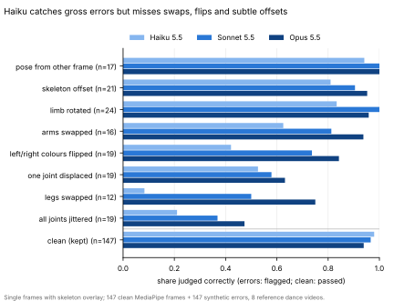

# Can a multimodal LLM tell whether a MediaPipe pose estimate is correct?

Viona asked (2026-11-07): "can you run some tests to see whether a multimodal llm
like claude Haiku can tell if a mediapipe pose estimation is correct or not? it
could be a single frame, or a sequence of frames, probably with the skeleton
overlay burned into them. go as far as you can with that test".

This is an exploratory, overnight agent experiment. It is not thesis material and
nothing was wired into the pipeline or the coaching flow. Code:
[`motion-pipeline/adhoc_analysis/llm_pose_judge/`](../motion-pipeline/adhoc_analysis/llm_pose_judge/README.md).

## Setup

**Videos.** Only reference videos, no participant recordings: seven public dance
videos from `reference_motions/videos/selenas-dancevideos/` (ballet, house, tango,
"You right" choreography, contemporary, "Texas Hold 'Em" duet, waacking) plus the
committed smoke-test reference `attention_zoom_out`. Their existing raw
`pose2d` CSVs (MediaPipe Holistic, pixel coordinates) were used as-is; MediaPipe
was not re-run.

**Overlay.** The 33 BlazePose landmarks and connections were drawn onto a crop
around the dancer: orange = the dancer's own left, blue = right, white = torso and
face links. The prompt explained this legend.

**Test sets.**

1. *Synthetic, single frame* (294 items). 147 "clean" frames: all 12 limb/torso
   joints with visibility ≥ 0.7, no frame-to-frame jump > 0.25 torso lengths,
   ≥ 1 s apart, then a visual check of thumbnails by the agent. Each clean frame
   got one perturbed copy, cycling through eight error types: arms swapped, legs
   swapped, one limb rotated 70-130°, one joint (plus its distal chain) displaced by
   0.25/0.5/1.0 torso lengths, whole skeleton offset by 0.3/0.6 torso lengths,
   Gaussian jitter on all joints (σ = 0.08/0.15 torso), left/right labels flipped
   (geometry unchanged, colours swapped), and the pose from another frame of the
   same video ≥ 1.5 s away. The crop box always comes from the clean pose.
2. *Synthetic, sequence* (86 items). 43 windows of six frames 0.2 s apart, shown as
   a numbered 3×2 grid, each in a clean and one perturbed version: one glitched
   frame, a two-frame left/right flip, the whole skeleton lagging 0.4 s, the
   skeleton freezing from frame 4, or a drift growing to 0.6 torso lengths. The
   model also had to name the bad frames.
3. *Natural failures* (40 items). Frames where the raw MediaPipe output itself is
   likely wrong were found automatically (single-frame spikes, left/right label
   jumps, low visibility; 72 candidates), then labelled by the agent from the raw
   crop and overlay: 18 wrong, 22 right, 32 too ambiguous and excluded. **These
   labels are an AI's visual judgement, not a human annotation**
   ([natural_labels.json](assets/2026-11-07-llm-pose-judge/natural_labels.json)).

**Models and calls.** `claude-haiku-5-5`, `claude-sonnet-5-5`, `claude-opus-5-5`,
default effort, called through headless Claude Code (`claude -p`, stream-json
input with base64 JPEG images, all tools disabled, a one-line system prompt).
There was no `ANTHROPIC_API_KEY` in the cloud container, so the Messages API was
not called directly. The served model was recorded per call and always matched.
Each answer was JSON: verdict, `p_incorrect`, problems text (and bad frames for
sequences). All 2,268 calls returned parseable JSON.

## Results

Positive class = "skeleton is incorrect". 95 % Wilson intervals in brackets.

| Run | n | Accuracy | Precision | Recall | Specificity | AUC |
|---|---|---|---|---|---|---|
| Haiku, single frame, overlay | 294 | 0.78 [0.73, 0.83] | 0.97 | 0.59 [0.50, 0.66] | 0.98 | 0.87 |
| Haiku, single frame, raw + overlay | 294 | 0.84 [0.79, 0.87] | 0.93 | 0.73 [0.65, 0.79] | 0.95 | 0.89 |
| Haiku, single frame, effort high | 294 | 0.81 | 0.98 | 0.64 | 0.99 | 0.88 |
| Sonnet, single frame, overlay | 294 | 0.86 [0.82, 0.90] | 0.96 | 0.76 [0.68, 0.82] | 0.97 | 0.93 |
| Opus, single frame, overlay | 294 | 0.88 [0.84, 0.91] | 0.93 | 0.82 [0.75, 0.88] | 0.94 | 0.94 |
| Haiku, sequence | 86 | 0.78 [0.68, 0.85] | 1.00 | 0.56 [0.41, 0.70] | 1.00 | 0.82 |
| Haiku, sequence, effort high | 86 | 0.85 | 0.97 | 0.72 | 0.98 | 0.89 |
| Sonnet, sequence | 86 | 0.86 [0.77, 0.92] | 0.86 | 0.86 [0.73, 0.93] | 0.86 | 0.95 |
| Opus, sequence | 86 | 0.95 [0.89, 0.98] | 0.95 | 0.95 [0.85, 0.99] | 0.95 | 0.98 |
| Haiku, natural | 40 | 0.78 [0.62, 0.88] | 0.76 | 0.72 [0.49, 0.88] | 0.82 | 0.85 |
| Haiku, natural, raw + overlay | 40 | 0.75 | 0.70 | 0.78 | 0.73 | 0.80 |
| Sonnet, natural | 40 | 0.88 [0.74, 0.95] | 0.88 | 0.83 [0.61, 0.94] | 0.91 | 0.94 |
| Opus, natural | 40 | 0.78 [0.62, 0.88] | 0.70 | 0.89 [0.67, 0.97] | 0.68 | 0.93 |

Detection rate by error type (single frame, overlay only):

(SVG, because this cloud session could not upload Git LFS objects, which PDF and
PNG are here; the PDF is in the project files under `llm-pose-judge/`. All numbers in
[summary.json](assets/2026-11-07-llm-pose-judge/summary.json); every individual
judgement with the model's stated reason in
[judgements.jsonl](assets/2026-11-07-llm-pose-judge/judgements.jsonl).)

Findings:

- **Haiku is a conservative judge.** When it says "incorrect" it is nearly always
  right (precision 0.97), but at its own verdict it misses about 40 % of injected
  errors. Its `p_incorrect` ranks items reasonably (AUC 0.87), so a lower
  threshold trades specificity for recall: at `p_incorrect ≥ 0.3`, recall 0.69 and
  specificity 0.91.
- **What Haiku sees and misses.** Gross errors are caught: pose from another frame
  16/17, limb rotated 20/24, skeleton offset 17/21, displaced joint at 1.0 torso
  lengths 7/8. Subtle or semantic errors are mostly missed: legs swapped 1/12,
  jitter 4/19 (0/7 at σ = 0.08), left/right colour flip 8/19, displaced joint at
  0.25 torso lengths 0/5. With the overlay alone, no model caught the 0.25-torso displacement (0/5 each); Haiku with the raw frame caught 2/5.
- **Showing the raw frame next to the overlay helps Haiku** on synthetic errors
  (recall 0.59 → 0.73, specificity 0.98 → 0.95), but not on the natural set
  (0.78 → 0.75 accuracy, within noise at n = 40).
- **Sequences:** Haiku flags none of the clean windows but detects only 24/43
  perturbed ones. It misses most single-frame glitches (2/8) and two-frame L/R
  flips (2/8), while lag is easy (9/9). When it flags a window it always points at
  at least one truly bad frame (24/24). Opus reaches 0.95 on both recall and
  specificity and localises every detected window.
- **Effort:** `--effort high` on Haiku raised single-frame recall 0.59 → 0.64 and
  sequence recall 0.56 → 0.72 at almost the same specificity and cost.
- **Run-to-run consistency:** a second identical Haiku single-frame run agreed on
  267/294 verdicts (Cohen's κ = 0.78). Its recall was 0.56, so differences of a
  few points between Haiku conditions are within run-to-run variation.
- **Bigger models are better, mainly on left/right semantics:** L/R colour flips
  8/19 (Haiku), 14/19 (Sonnet), 16/19 (Opus); legs swapped 1/12, 6/12, 9/12.
- **Cost and latency** (as reported by the CLI, per call): Haiku about $0.001,
  Sonnet $0.013, Opus $0.027; median wall time 7-10 s per call including CLI
  start-up. The whole experiment (2,268 calls) cost about $18.50.

## Caveats

- The "clean" frames are unmodified MediaPipe output, not ground truth. After the
  runs, the agent looked again at the 18 clean frames that at least one model
  flagged. About five of them look like genuine MediaPipe errors that the
  thumbnail audit missed (left/right leg swap on a raised leg, a leg drawn up to
  the head while crouching, a skeleton mixing two dancers, a back-facing dancer
  with flipped colours). So some "false positives", especially Opus's, are
  probably correct detections, and the specificities above are lower bounds. The
  labels were not changed after seeing results.
- Natural-failure labels come from one AI labeller, and the 32 most ambiguous
  candidates were dropped, which makes this set easier than real data.
- Synthetic errors are a proxy. The real MediaPipe failures seen here were mostly
  limbs collapsing onto the wrong body part during turns or occlusion, left/right
  flips on back-facing dancers, and switching to the other dancer in the duet.
- One prompt wording, one overlay style, default effort, JPEG at 768 px long
  side (400 px per tile in sequence grids). None of these were tuned.
- Called through Claude Code, not the raw API. Claude Code still adds some context
  of its own even with `--system-prompt`, so a direct API call could behave
  slightly differently.

## Decision / next step

Nothing is decided; this is input for Viona. As measured here, Haiku alone works
as a high-precision filter for gross tracking failures (wrong frame, offset, a limb
pointing the wrong way), not as a general pose-correctness check. It is not
reliable for left/right confusion or small errors, which are the failure modes
that matter most for per-limb coaching metrics. Sonnet or Opus on sequences is much
stronger at 13-27× the per-call cost.

Possible next steps, not started:

1. Get a human (Viona) to label the natural candidates and the flagged "clean"
   frames, and recompute.
2. Combine cheap numeric checks (visibility, temporal spikes, L/R jumps) with an
   LLM pass only on suspicious windows, which is where the natural set came from.
3. Try Haiku with high effort and raw + overlay on sequences, and a lower
   `p_incorrect` threshold, before moving to a bigger model.

Generated datasets and raw outputs (rendered reference-video frames) are not in
Git. They were in the agent's cloud scratch space; the example sheets were
shared in the project thread.
